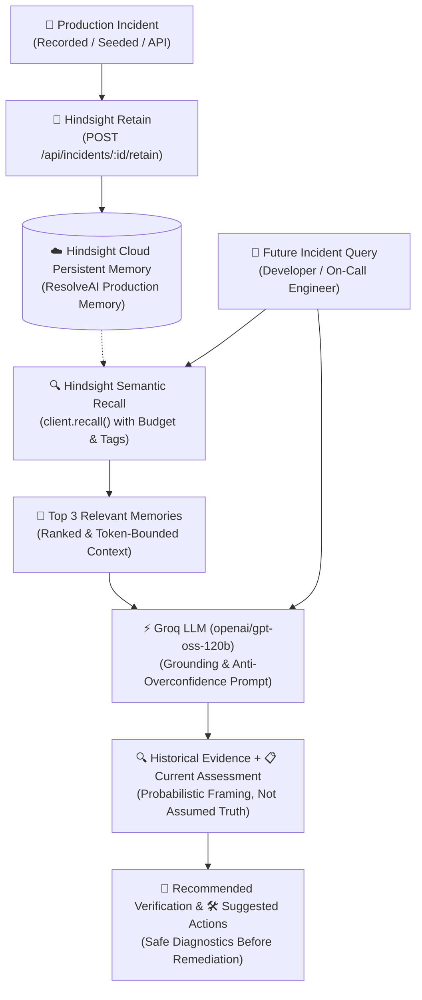

# ResolveAI 🧠⚡
> **AI Incident Response Agent for Software Teams — Grounded in Hindsight Persistent Memory**

[](https://api.hindsight.vectorize.io)
[](https://groq.com)
[](https://vitejs.dev)
[](https://nodejs.org)

---

## 1. What is ResolveAI?

**ResolveAI** is an intelligent AI incident response agent designed for modern engineering and SRE teams. 

When a production incident strikes, ResolveAI does not just offer generic, boilerplate troubleshooting steps. Instead, it integrates directly with **Hindsight**—a semantic cognitive memory system—to retain post-mortem knowledge from past outages (root causes, configuration pitfalls, remediation actions, and outcomes). When a recurring or similar failure occurs, ResolveAI automatically **recalls** relevant historical memories and equips on-call engineers with high-confidence, context-aware recovery guidance in seconds.

---

## 2. The Problem: The Stateless Triage Trap

In software engineering teams:
- **Recurring Outages:** Up to 70% of production issues are duplicates or variants of past incidents (e.g., misconfigured environment variables, pool exhaustion, cache stampedes).
- **Tribal Knowledge Lost:** Past post-mortems and emergency Slack threads are forgotten or scattered across Notion, Confluence, and Jira.
- **Stateless AI Fails:** Standard LLMs lack memory of your architecture and past incidents. They suggest generic checklists (*"Check container logs, verify network connectivity"*) rather than pinpointing the exact configuration or service setting that failed previously.

---

## 3. The Solution: Memory-Augmented Incident Response

ResolveAI solves this by using **Hindsight** as a persistent memory bank:
1. **Retain on Resolution:** When an incident is solved, its symptoms, root cause, verified fix, and environment are retained into Hindsight via `@vectorize-io/hindsight-client`.
2. **Recall on Triage:** When a new incident is reported, ResolveAI executes a semantic natural-language recall across Hindsight memories.
3. **Evidence-Grounded Recommendation:** The recalled memory is passed to Groq (openai/gpt-oss-120b), distinguishing past evidence from immediate hypotheses and recommending targeted steps.

### Comparison: With vs. Without Memory

| Metric / Experience | Without Memory (Generic AI) | With ResolveAI + Hindsight Memory |
| :--- | :--- | :--- |
| **Context** | Stateless; treats every incident as brand new | Correlates error symptoms with historical outages |
| **Initial Hypothesis** | Broad trial-and-error checklist | Specific prior root cause (e.g. `PAYMENT_API_URL`) |
| **Action Plan** | Generic suggestions | Exact verified remediation & restart steps |
| **MTTR Impact** | High manual triage latency | Rapid resolution grounded in past post-mortems |
| **Learning** | None | Continuously retains each new resolved incident |

---

## 4. Architecture



---

## 5. How Hindsight is Used

ResolveAI uses the official SDK:
```bash
npm install @vectorize-io/hindsight-client
```

Client initialization in `backend/services/hindsight.js`:
```javascript
import { HindsightClient } from "@vectorize-io/hindsight-client";

const client = new HindsightClient({
  baseUrl: process.env.HINDSIGHT_BASE_URL || "https://api.hindsight.vectorize.io",
  apiKey: process.env.HINDSIGHT_API_KEY
});
```

### 6. How `retain()` Works
When an incident is resolved, ResolveAI constructs a structured memory document:
```javascript
const content = [
  `Incident: ${incident.title}`,
  `Service: ${incident.service}`,
  `Severity: ${incident.severity}`,
  `Symptoms: ${incident.symptoms}`,
  `Root cause: ${incident.rootCause}`,
  `Resolution: ${incident.resolution}`,
  `Outcome: ${incident.outcome}`
].join("\n");

await client.retain(bankId, content, {
  timestamp: new Date(incident.createdAt),
  context: `ResolveAI Incident Response for ${incident.service}`,
  metadata: {
    service: incident.service,
    severity: incident.severity
  },
  tags: ["incident", incident.service.toLowerCase(), incident.severity.toLowerCase()]
});
```

### 7. How `recall()` Works
When a user describes an issue, ResolveAI queries Hindsight:
```javascript
const response = await client.recall(bankId, userQuery, {
  budget: "mid",
  maxTokens: 4096
});

// response.results contains array of { id, text, context, scores, metadata }
```

### 8. How Groq is Used
The recalled memories are injected into Groq's system prompt using `openai/gpt-oss-120b`:
```javascript
import Groq from "groq-sdk";
const groq = new Groq({ apiKey: process.env.GROQ_API_KEY });

const completion = await groq.chat.completions.create({
  model: process.env.GROQ_MODEL || "openai/gpt-oss-120b",
  messages: [
    { role: "system", content: systemPromptWithMemoryGuidance },
    { role: "user", content: `RELEVANT MEMORY:\n${recalledText}\n\nCURRENT QUERY:\n${userQuery}` }
  ],
  temperature: 0.2
});
```

---

## 9. Project Structure

```text
ResolveAI/
├── backend/
│   ├── server.js                # Express application & middleware
│   ├── package.json             # Backend dependencies
│   ├── .env.example             # Environment template
│   ├── .env                     # Local configuration (never committed)
│   ├── routes/
│   │   ├── health.js            # GET /api/health (Hindsight & Groq status)
│   │   ├── incidents.js         # GET/POST /api/incidents & retain
│   │   ├── memory.js            # POST /api/memory/retain & recall
│   │   └── assistant.js         # POST /api/assistant (orchestration)
│   └── services/
│       ├── hindsight.js         # Official @vectorize-io/hindsight-client service
│       ├── groq.js              # Groq SDK LLM prompt synthesis & fallback
│       └── incidentStore.js     # Incident data model & demo records
├── frontend/
│   ├── package.json             # React, Vite, Lucide dependencies
│   ├── vite.config.js           # Reverse proxy to port 5000
│   ├── index.html               # Responsive HTML entry
│   └── src/
│       ├── main.jsx             # React entry point
│       ├── App.jsx              # Main tab orchestrator & modals
│       ├── index.css            # Dark developer dashboard design system
│       └── components/
│           ├── Navbar.jsx       # Brand, live status badges, demo launcher
│           ├── Dashboard.jsx    # Metrics, visual flow diagram, comparison
│           ├── Assistant.jsx    # Chat UI with memory toggle & memory evidence
│           ├── Incidents.jsx    # Incident audit table & retention triggers
│           ├── MemoryBank.jsx   # Live recall search & Hindsight stats
│           ├── DemoScenarioModal.jsx  # Canonical 2-step demo walk-through
│           ├── NewIncidentModal.jsx   # Record incident form
│           └── IncidentDetailModal.jsx # Incident post-mortem inspector
├── package.json                 # Root script runner
├── .env.example                 # Root environment template
├── .gitignore                   # Ignore node_modules, .env, dist
└── README.md                    # Documentation
```

---

## 10. Environment Variables

Create and configure your local environment file at `backend/.env`:

```env
PORT=5000

# Groq API Key (get from https://console.groq.com)
GROQ_API_KEY=gsk_your_groq_key_here
GROQ_MODEL=openai/gpt-oss-120b

# Hindsight Cloud Configuration (get from https://api.hindsight.vectorize.io)
HINDSIGHT_API_KEY=your_hindsight_api_key_here
HINDSIGHT_BASE_URL=https://api.hindsight.vectorize.io
HINDSIGHT_BANK_ID=resolveai
```

> 🔒 **Security Notice:** Never commit `.env` or paste keys in public repositories. `backend/.env` is ignored by `.gitignore`.

---

## 11. Quick Start Guide

### Step 1: Install Dependencies

```powershell
# From the project root (ResolveAI/):
npm run install:all
```
*(Or install in each directory individually)*:
```powershell
cd backend
npm install
cd ../frontend
npm install
```

### Step 2: Configure Environment Keys

Open `backend/.env` in your text editor and insert your `HINDSIGHT_API_KEY` and `GROQ_API_KEY`.

### Step 3: Run Backend and Frontend

You can run both concurrently from the root:
```powershell
npm run dev
```

Or run in separate terminals:

**Terminal 1 (Backend)**:
```powershell
cd backend
npm run dev
```
*Backend runs at http://localhost:5000*

**Terminal 2 (Frontend)**:
```powershell
cd frontend
npm run dev
```
*Frontend runs at http://localhost:3000*

---

### Step 4: Deploying to Render (Unified Public Web Service)

ResolveAI is configured for production deployment as **ONE single Render Web Service** serving both the compiled React frontend and Express backend.

1. Create a new **Web Service** on [Render](https://render.com) connected to your repository.
2. Configure the deployment settings:
   - **Environment:** `Node`
   - **Build Command:** `npm run render-build` (or `npm run build`)
   - **Start Command:** `npm start`
   - **Health Check Path:** `/api/health`
3. Add the following **Environment Variables** in the Render Dashboard:
   - `GROQ_API_KEY`: *(Your Groq API key)*
   - `GROQ_MODEL`: `openai/gpt-oss-120b`
   - `HINDSIGHT_API_KEY`: *(Your Hindsight Cloud API key)*
   - `HINDSIGHT_BASE_URL`: `https://api.hindsight.vectorize.io`
   - `HINDSIGHT_BANK_ID`: *(Your Hindsight Bank ID, e.g., `resolveai`)*
   *(Note: Render automatically supplies `PORT`)*

---

## 12. Canonical Demo Scenario

To demonstrate the power of Hindsight persistent memory:

1. **Open the Dashboard** at `http://localhost:3000`.
2. Click **"Launch Demo Scenario"** in the top navigation bar.
3. **Step 1 (Retain):** The modal displays the canonical past incident:
   - **Title:** `Payment API returning HTTP 500 after deployment`
   - **Root Cause:** `Incorrect PAYMENT_API_URL environment variable`
   - **Resolution:** `Restore the correct environment variable and restart the payment service.`
   - Click **"1. Retain Incident to Hindsight"**. Hindsight stores this cognitive memory.
4. **Step 2 (Recall & Resolve):** Click **"2. Ask AI Assistant"**. The prompt automatically queries:
   > *"Payment API is returning HTTP 500 after a deployment. What should I check?"*
5. Notice the **Relevant Memory Recalled** box above the AI recommendation highlighting the exact historical correlation.
6. Toggle the **"Memory Enabled / Memory Off"** switch in the chat header to immediately observe the difference between an informed response vs. generic troubleshooting!

---

## 13. API Endpoints Reference

| Method | Endpoint | Description |
| :--- | :--- | :--- |
| `GET` | `/api/health` | Service health, Hindsight connection, Groq config |
| `GET` | `/api/incidents` | List all incidents & summary stats |
| `POST` | `/api/incidents` | Create incident (with optional immediate retain) |
| `POST` | `/api/incidents/:id/retain` | Retain an existing incident to Hindsight |
| `POST` | `/api/incidents/seed-demo` | Seed canonical demo incident and retain |
| `POST` | `/api/memory/retain` | Retain custom memory block in Hindsight |
| `POST` | `/api/memory/recall` | Recall memories matching natural language query |
| `GET` | `/api/memory/stats` | Telemetry & memory audit log |
| `POST` | `/api/assistant` | Main AI response endpoint (Recall -> Groq -> Synthesis) |

---

## 14. Future Improvements

- **PagerDuty & Slack Bot Integration:** Automatically retain post-mortems from resolved incident channels and bot interactions.
- **Automated Runbook Execution:** Allow ResolveAI to execute pre-approved diagnostic scripts (e.g. `kubectl get pods -l app=payment-api`).
- **Multi-Tenant Bank Scoping:** Isolate memories by engineering domain (e.g. `payments-bank`, `data-infra-bank`).
- **Telemetry Ingestion:** Connect to Prometheus / Datadog webhooks for automatic incident card creation.

---

## License
MIT © 2026 ResolveAI Team
